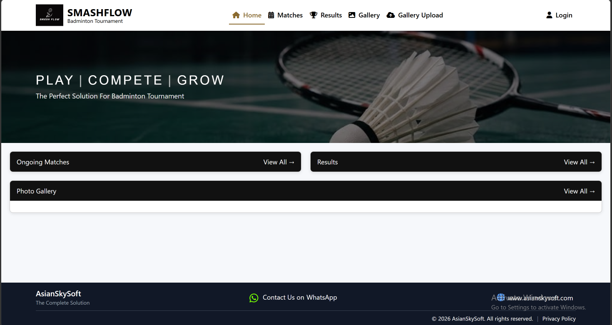
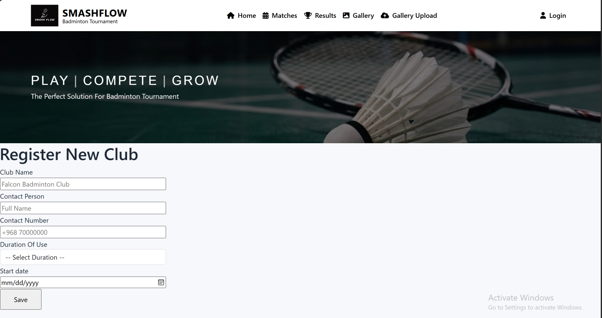
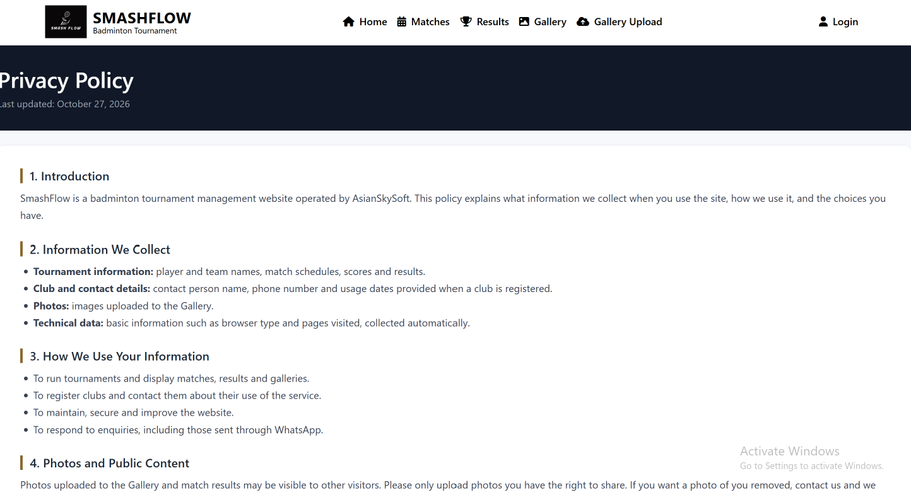
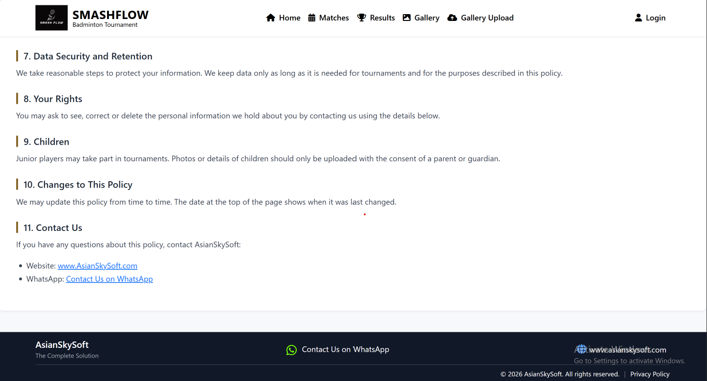

# SmashFlow – Badminton Tournament Website

SmashFlow is a responsive web application for managing badminton tournaments and registering clubs to use the app.

## Features

- Master page with responsive navigation and footer
- Club registration form: club name, contact person, contact number, duration of use and start date
- Terms and Conditions page
- Responsive layout for laptop, tablet and mobile

## Technologies Used

- ASP.NET 
- C#
- Bootstrap 5
- HTML, CSS, JavaScript
- MySQL

## About This Repository

This repository contains the main source code of the project.

##Screenshots

